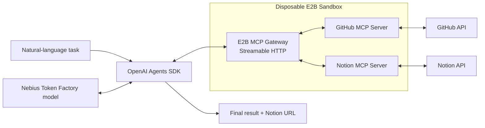

<div align="center">

# RepoBrief · Docker E2B MCP Agent

### Turn GitHub repositories into a polished Notion brief—through one secure, disposable MCP gateway.

[](https://tirth1263.github.io/docker-e2b-mcp-agent/)
[](https://www.python.org/)
[](https://github.com/tirth1263/docker-e2b-mcp-agent/actions/workflows/ci.yml)
[](LICENSE)

[Live demo](https://tirth1263.github.io/docker-e2b-mcp-agent/) · [Quickstart](#quickstart) · [Architecture](#architecture) · [Security](#security-model)

</div>

---

## Why this project exists

AI agents become much more useful when they can work across the tools where teams already keep their code and knowledge. They also become riskier when every external tool runs directly on a developer machine with broad, long-lived credentials.

**RepoBrief** demonstrates a cleaner pattern:

1. Start a fresh [E2B](https://e2b.dev/) cloud sandbox.
2. Run the official GitHub and Notion MCP servers inside that isolated environment.
3. Connect the [OpenAI Agents SDK](https://openai.github.io/openai-agents-python/) to E2B's authenticated MCP gateway over Streamable HTTP.
4. Use a [Nebius Token Factory](https://tokenfactory.nebius.com/) model to plan and execute the workflow.
5. Destroy the sandbox when the task finishes—even if the run fails.

The included sample task reads your GitHub repositories, ranks them by stars, and creates a Notion page that highlights your top three projects with descriptions, languages, star counts, and direct links.

> [!IMPORTANT]
> The public website is an interactive project showcase. It never asks for or handles credentials. The real agent runs locally or in your own server environment, where tokens remain server-side.

## What you get

- **A working Python 3.13+ agent** with a small, typed, testable package structure.
- **One E2B MCP gateway** for GitHub and Notion instead of separate client integrations.
- **Nebius-powered reasoning** through an OpenAI-compatible model adapter.
- **Optional OpenAI tracing** for observing Agents SDK runs.
- **Safe lifecycle management** that tears down the E2B sandbox in a `finally` block.
- **A friendly CLI** for config validation, tool discovery, the default demo, and custom tasks.
- **A production website** deployed with GitHub Pages.
- **CI, tests, linting, a lockfile, Docker support, and Dependabot** for a complete repository—not just a snippet.

## Architecture



| Layer | Responsibility |
| --- | --- |
| `AsyncSandbox` | Creates the isolated E2B runtime with MCP server configuration. |
| `MCPServerStreamableHttp` | Authenticates the Agents SDK to E2B's MCP gateway. |
| `Agent` + `Runner` | Discovers tools, plans calls, and completes the workflow. |
| `OpenAIChatCompletionsModel` | Adapts the Agents SDK to Nebius's OpenAI-compatible API. |
| GitHub MCP | Reads authenticated repository metadata. |
| Notion MCP | Finds an accessible parent and creates the final page. |

## Prerequisites

- Python **3.13 or newer**
- [`uv`](https://docs.astral.sh/uv/getting-started/installation/) package manager
- [E2B API key](https://e2b.dev/dashboard)
- [Nebius Token Factory API key](https://tokenfactory.nebius.com/)
- [GitHub personal access token](https://github.com/settings/tokens)
- [Notion integration token](https://www.notion.so/profile/integrations)
- Optional but recommended: [OpenAI API key](https://platform.openai.com/api-keys) for Agents SDK tracing

For a classic GitHub token, the original demo uses `repo`, `read:user`, and `read:org`. For production, prefer a fine-grained token with access limited to the repositories and read permissions the workflow actually needs.

Share at least one destination page with your Notion integration. Setting `NOTION_PARENT_PAGE_ID` makes page placement deterministic.

## Quickstart

### 1. Clone the repository

```bash
git clone https://github.com/tirth1263/docker-e2b-mcp-agent.git
cd docker-e2b-mcp-agent
```

### 2. Install dependencies

```bash
uv sync
```

`uv` creates an isolated virtual environment and installs the versions recorded in `uv.lock`.

### 3. Configure environment variables

Copy the safe template:

```bash
cp .env.example .env
```

On PowerShell:

```powershell
Copy-Item .env.example .env
```

Then replace the placeholders in `.env`:

```dotenv
E2B_API_KEY=your_e2b_api_key_here
OPENAI_API_KEY=your_openai_api_key_here
NOTION_TOKEN=your_notion_integration_token_here
GITHUB_TOKEN=your_github_personal_access_token_here
NEBIUS_API_KEY=your_nebius_api_key_here

# Recommended destination shared with the integration
NOTION_PARENT_PAGE_ID=your_parent_page_id
```

The `.env` file is ignored by Git. Never commit real credentials.

### 4. Validate configuration

```bash
uv run main.py --check-config
```

This validates required values without contacting E2B, GitHub, Notion, Nebius, or OpenAI. Output contains non-secret settings only.

### 5. Run the demo

```bash
uv run main.py
```

The default task is:

> List my GitHub repositories, rank them by stargazer count, and create a Notion page titled “My Top GitHub Repositories” that summarizes the top 3.

## Usage

Discover all MCP tools exposed by the sandbox:

```bash
uv run main.py --list-tools
```

Give the agent another natural-language task:

```bash
uv run main.py --prompt "Create a Notion engineering digest for my five most recently updated repositories."
```

Use the installed console script instead of `main.py`:

```bash
uv run e2b-mcp-agent --check-config
uv run e2b-mcp-agent
```

### Environment reference

| Variable | Required | Default | Purpose |
| --- | :---: | --- | --- |
| `E2B_API_KEY` | Yes | — | Creates the isolated E2B sandbox. |
| `GITHUB_TOKEN` | Yes | — | Authenticates the official GitHub MCP server. |
| `NOTION_TOKEN` | Yes | — | Authenticates the official Notion MCP server. |
| `NEBIUS_API_KEY` | Yes | — | Calls the Nebius-hosted language model. |
| `OPENAI_API_KEY` | No | — | Enables OpenAI Agents SDK tracing when present. |
| `NOTION_PARENT_PAGE_ID` | No | auto-discover | Pins the destination Notion page. |
| `NEBIUS_MODEL` | No | `moonshotai/Kimi-K2.5` | Selects the Token Factory model. |
| `NEBIUS_BASE_URL` | No | `https://api.tokenfactory.nebius.com/v1/` | OpenAI-compatible model endpoint. |
| `SANDBOX_TIMEOUT` | No | `900` | E2B sandbox lifetime in seconds (60–3600). |
| `MAX_TURNS` | No | `20` | Maximum Agents SDK loop turns (2–50). |
| `ENABLE_TRACING` | No | `true` | Enables tracing when an OpenAI key is available. |

## Security model

This is a demonstration, but the implementation makes several production-minded choices:

- Credentials are read from environment variables and are never logged.
- The MCP bearer token exists only for the lifetime of one run.
- The public website contains no backend, secret form, or embedded API credential.
- E2B sandbox teardown runs whether the agent succeeds, raises, or is interrupted.
- The agent is instructed to treat GitHub as read-only unless a custom task explicitly requests a mutation.
- `--check-config` returns a deliberately redacted summary.
- CI runs with no service credentials because tests mock boundaries instead of calling user accounts.

> [!CAUTION]
> Natural-language instructions are not an authorization boundary. For production, pair the prompt rules with fine-grained tokens, MCP tool filters, approval gates for write tools, audit logs, budgets, and timeouts appropriate to your organization.

## Development

Install all development dependencies:

```bash
uv sync --all-extras
```

Run the quality suite:

```bash
uv run ruff check .
uv run pytest
uv build
```

Project layout:

```text
.
├── main.py                         # `uv run main.py` entry point
├── src/docker_e2b_mcp_agent/
│   ├── agent.py                    # Agent + Nebius model adapter
│   ├── cli.py                      # CLI commands and error handling
│   ├── config.py                   # Typed, validated environment config
│   ├── sandbox.py                  # E2B and MCP lifecycle
│   └── workflow.py                 # Tool discovery and agent runs
├── tests/                          # Offline unit tests
├── site/                           # Static production website
├── .github/workflows/              # CI and GitHub Pages deployment
├── Dockerfile
└── pyproject.toml
```

## Docker

The agent itself does not require local Docker—E2B runs the MCP containers in the cloud. A local image is included for reproducible deployment environments:

```bash
docker compose run --rm agent
```

The command reads credentials from your uncommitted `.env` file.

## Website deployment

The landing page in `site/` is plain HTML, CSS, and JavaScript with no build-time dependency. A GitHub Actions workflow publishes it to GitHub Pages on every change to `site/`:

**[https://tirth1263.github.io/docker-e2b-mcp-agent/](https://tirth1263.github.io/docker-e2b-mcp-agent/)**

To preview the exact static files locally during development:

```bash
python -m http.server 8080 --directory site
```

## Troubleshooting

**“Missing required environment variable(s)”**
Copy `.env.example` to `.env` and fill every required token. Placeholder strings are not valid credentials.

**No Notion parent can be found**
Share a page with your integration, copy its page ID, and set `NOTION_PARENT_PAGE_ID`.

**The GitHub server cannot see private repositories**
Check the token's repository selection, permissions, organization SSO authorization, and expiration.

**The model does not call tools reliably**
Choose a Nebius model with function-calling support and keep `NEBIUS_MODEL` configurable. Available model IDs can change, so consult the Token Factory model catalog.

**A run leaves unexpectedly**
The `finally` block still asks E2B to destroy the sandbox. E2B's configured timeout is an additional upper bound.

## Built with

- [E2B MCP Gateway quickstart](https://e2b.dev/docs/mcp/quickstart)
- [E2B MCP server catalog](https://e2b.dev/docs/mcp/available-servers)
- [OpenAI Agents SDK MCP guide](https://openai.github.io/openai-agents-python/mcp/)
- [OpenAI Agents SDK model guide](https://openai.github.io/openai-agents-python/models/)
- [Nebius Token Factory OpenAI compatibility](https://docs.tokenfactory.nebius.com/switch)
- [Model Context Protocol](https://modelcontextprotocol.io/)

## Contributing

Issues and pull requests are welcome. See [CONTRIBUTING.md](CONTRIBUTING.md) for the local checks and contribution flow.

## License

Released under the [MIT License](LICENSE).

---

<div align="center">
Built by <a href="https://github.com/tirth1263">Tirth Rank</a> for developers exploring secure, useful MCP automation.
</div>
